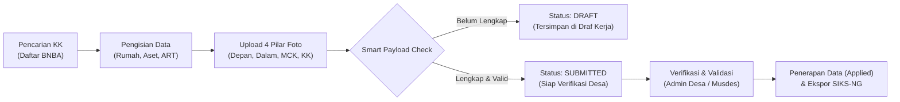

<p align="center">
  
</p>

<h1 align="center">SINDEN</h1>
<h3 align="center">Sistem Informasi Data Ekonomi dan Sosial Desa</h3>

<p align="center">
  <strong>Platform Terpadu Pengelolaan, Verifikasi, Validasi, dan Pengusulan Data Kemiskinan serta Perlindungan Sosial Tingkat Desa & Kecamatan</strong>
</p>

<p align="center">
  <a href="#fitur-utama"></a>
  <a href="https://codeigniter.com"></a>
  <a href="https://php.net"></a>
  <a href="https://mariadb.org"></a>
  <a href="#keamanan"></a>
</p>

---

## 📖 Tentang SINDEN

**SINDEN** (*Sistem Informasi Data Ekonomi dan Sosial Desa*) adalah aplikasi tata kelola satu data kemiskinan dan kesejahteraan sosial yang dirancang khusus untuk memfasilitasi kebutuhan verifikasi, validasi, pembaruan, dan monitoring bantuan sosial di tingkat desa/kelurahan hingga kecamatan.

Aplikasi ini mengintegrasikan dua poros besar instrumen data nasional:
1. **DTSEN (Data Terpadu Sosial Ekonomi Nasional / Sensus Ekonomi - Regsosek)**: Pengumpulan basis data sosial ekonomi, kondisi perumahan standar BPS, kepemilikan aset, sanitasi, profiling anggota keluarga (ART), dan pemeringkatan desil kesejahteraan.
2. **DTKS (Data Terpadu Kesejahteraan Sosial - Kemensos RI)**: Pengusulan berkala program bantuan sosial nasional (PKH, BPNT, PBI-JKN, dsb.), pendataan PPKS, verifikasi anomali data kependudukan, hingga pengelolaan Berita Acara Musyawarah Desa (Musdes/Muskel).

---

## 🌟 Modul & Fitur Unggulan

### 1. 📊 Modul DTSEN (Sosial Ekonomi / Regsosek)
* **Pembaruan Data Keluarga (Sensus Ekonomi Terintegrasi)**:
  * Penginputan multi-tab: *Profil Keluarga*, *Kondisi Rumah & Bangunan BPS*, *Sanitasi & Air Minum*, *Kepemilikan Aset*, dan *4 Pilar Dokumentasi Foto*.
  * **Smart Strict Payload Validation**: Pemisahan tegas data berstatus **Draft** (belum lengkap) dan **Submitted** (lengkap dan memenuhi standar validasi BPS/Kemensos).
  * Manajemen Anggota Rumah Tangga (ART) lengkap: NIK padan Dukcapil, status hubungan (SHDK), jenjang & partisipasi sekolah, ketenagakerjaan, serta kondisi kesehatan/disabilitas.
* **Analisis & Sinkronisasi Desil**:
  * Pengelompokan desil kemiskinan (Desil 1 s.d. 10 dan Desil Kemiskinan Ekstrem / P3KE).
  * Sinkronisasi data desil per Kartu Keluarga maupun kalkulasi desil serentak (*Global Sync*) lengkap dengan rekam jejak (*Desil History*).
* **Matriks Penentuan Kemiskinan Objektif**:
  * Modul seleksi kelayakan berbasis indikator terukur: Aset, Kondisi Fisik Rumah, Tanggungan Keluarga, Status Pekerjaan, Penghasilan Ekonomi, dan Kondisi Kesehatan.
  * Fitur verifikasi, validasi operator desa, hingga mekanisme *Rollback* data usulan jika terjadi kesalahan.
* **Usulan Bansos DTSEN**:
  * Pengusulan bansos yang disinkronisasikan langsung dengan status kelayakan desil warga.
  * Dilengkapi widget **Countdown & Deadline Alert** menuju batas cut-off bulanan (tanggal 15).
* **Master KKS & Dokumentasi Bansos KKS**:
  * Pendataan Kartu Keluarga Sejahtera (KKS), import pembagian tugas verifikasi dari SIKS-NG, serta pencatatan dokumentasi serah terima bansos dengan foto geotagging dan tanda tangan digital.
* **Modul Banpang (Bantuan Pangan Bulog)**:
  * Fitur **Scanner Barcode/QR** terintegrasi kamera untuk pencatatan distribusi beras bantuan pangan.
  * Penanganan khusus **Data Reject Bulog**: dokumentasi kamera petugas entri (PENTRI), verifikasi admin desa, dan konfirmasi otomatis ke warga.
* **KPM Exclude (Blacklist / Graduasi Bansos)**:
  * Penandaan keluarga yang telah mampu (*graduasi mandiri*), menjadi ASN/TNI/Polri, meninggal dunia tanpa ahli waris, atau anomali data.
  * Cetak surat pernyataan penolakan/keluar dari bansos dan Berita Acara resmi format Word/PDF.
* **Perlindungan Sosial Ketenagakerjaan (BPJSTK)**:
  * Manajemen kepesertaan jaminan kecelakaan & kematian kerja bagi pekerja rentan bukan penerima upah (BPU).
* **PPKS 5 PAS & Monev PKH**:
  * Monitoring dan evaluasi pencairan PKH serta penanganan Pemerlu Pelayanan Kesejahteraan Sosial (PPKS).

### 2. 🏛️ Modul DTKS & Bantuan Sosial Sektoral
* **PBI-JKN (Penerima Bantuan Iuran Jaminan Kesehatan)**:
  * Pengelolaan Master Data PBI aktif, rekapitulasi data dinonaktifkan, dan sistem workflow **Reaktivasi PBI** yang terintegrasi pengajuan ke Dinas Sosial/SIKS-NG.
* **Pengusulan DTKS Baru**:
  * Pendaftaran perorangan maupun keluarga baru lengkap dengan dokumen kependudukan (KTP-el/KIA).
* **Verval & Anomali Data Kependudukan**:
  * Modul verifikasi lapangan untuk data anomali SIKS-NG (NIK ganda, perbedaan penulisan nama, SHDK tidak sinkron, dll.).
  * Modul pendataan teritorial khusus (PDTT).
* **Program Afirmatif Khusus**:
  * Bantuan Pengganti BPNT, Afirmasi Janda & Yatim Piatu, DKM (Dewan Kemakmuran Masjid / Kemiskinan Ekstrem), dan Afirmasi Pendidikan KIP / Non-KIP.
* **Geotagging & Auto-Watermark Spasial**:
  * Pipeline pengolahan citra bawaan (GD Native): kompresi otomatis (1280px), perbaikan orientasi EXIF, dan stempel *watermark* permanen berisi nama petugas pencacah, jenis kegiatan, koordinat GPS (Latitude/Longitude), dan waktu pengambilan.

### 3. 🛡️ Keamanan, Otomasi & Portal Publik
* **Satpam Single-Device Login**: Memastikan satu akun hanya dapat login dari satu perangkat aktif dalam satu waktu melalui validasi token sesi dinamis di basis data (`dtks_users_login`).
* **WhatsApp Gateway Notification (Fonnte API & Cron)**:
  * Pengingat otomatis (*WhatsApp Reminder*) bagi para operator dan enumerator desa menjelang batas akhir usulan bulanan.
* **Public Landing Page & Citizen Portal**:
  * Halaman depan responsif dengan CMS Berita & Artikel Desa, integrasi mode terang/gelap (*Dark/Light Mode*), serta formulir publik **Cek Mandiri Usulan Bansos**.
* **Auto-Deploy GitHub to cPanel**:
  * Endpoint webhook terproteksi token rahasia untuk penyebaran kode otomatis saat perubahan dipusatkan ke repositori.

---

## 👥 Matriks Peran Pengguna (Role-Based Access Control)

Aplikasi SINDEN menerapkan kontrol akses ketat berjenjang dan pemetaan penugasan wilayah operasional yang humanis:

| Role ID | Nama Peran | Lingkup Akses & Wewenang |
| :---: | :--- | :--- |
| **1** | **Super Admin** | Akses penuh sistem, manajemen konfigurasi database, menu dinamis, artikel, dan pengaturan global. |
| **2** | **Admin Kecamatan** | Monitoring data lintas desa se-kecamatan, verifikasi rekapitulasi, pengawasan kuota bansos kecamatan. |
| **3** | **Admin Desa / Operator Utama** | Mengelola usulan desa, verifikasi lapangan, penentuan kemiskinan, manajemen akun enumerator, dan pengaturan WhatsApp desa. |
| **4** | **Petugas Entri / Enumerator** | Melakukan survei lapangan, input pembaruan data keluarga, dan upload dokumentasi foto sesuai wilayah RT/RW penugasan. |
| **5** | **Auditor / Pengawas** | Hak akses baca (*read-only*) untuk kebutuhan audit data, rekapitulasi capaian, dan monitoring perlindungan sosial. |
| **6** | **Petugas Sensus Ekonomi (SE)** | Enumerator khusus sensus ekonomi dengan akses instrumen pencarian KK dan pengisian modul sosial ekonomi keluarga. |
| **99** | **User Baru (Pending)** | Akun baru terdaftar yang belum diaktifkan atau belum diberikan mandat wilayah tugas oleh Admin Desa. |

> [!NOTE]
> **Wilayah Tugas Humanis**: Petugas Entri (Role 4 & 6) dapat ditugaskan secara presisi ke beberapa RT dalam RW tertentu dengan notasi terstruktur, misalnya: `001:001,002,003|002:001,002`, yang otomatis diuraikan menjadi tampilan yang mudah dipahami di seluruh aplikasi.

---

## 📋 Standar Operasional Prosedur (SOP) & Pengusulan Data

Bagian ini wajib diperhatikan oleh seluruh Petugas Entri, Operator Desa, dan Verifikator dalam pengusulan dan pembaruan data DTKS / DTSEN ke SIKS-NG:

### 1. Validitas Dokumen Kependudukan
- Seluruh anggota keluarga yang diusulkan **wajib memiliki NIK dan KK yang padan dengan data Ditjen Dukcapil Kemendagri**.
- Untuk anggota keluarga berusia **0 s.d. 17 tahun**, pastikan data tercatat pada Kartu Keluarga atau telah memiliki Kartu Identitas Anak (KIA) yang valid.
- Format penulisan NIK dan Nomor KK wajib tepat **16 digit angka**, tanpa spasi dan tanpa tanda baca.
- Penulisan nama warga **tidak diperkenankan** mencantumkan gelar depan/belakang, gelar adat, maupun tanda baca khusus seperti petik (`'`), koma (`,`), titik (`.`), atau garis miring (`/`), kecuali nama pada dokumen resmi KTP-el tercetak demikian.
- Format tanggal lahir/kehamilan harus mengikuti standar baku: `DD / MM / YYYY` (Contoh: `21 / 12 / 1997`).

### 2. Aturan Program Bantuan Sosial
- **Usulan Keluarga Baru**: Jika seluruh anggota keluarga belum pernah masuk dalam DTKS/DTSEN, seluruh anggota keluarga dientri ke dalam sistem. Saat diekspor ke format template Kemensos (Excel V.4/V.5), program bantuan disesuaikan:
  - Kepala Keluarga / Pengurus Rumah Tangga (Ibu/Ayah) $\rightarrow$ Program **BPNT** atau **PKH**.
  - Anggota Keluarga lain $\rightarrow$ Program **PBI-JKN** atau **NON BANSOS**.
- **Penambahan Anggota Keluarga**: Hanya mendaftarkan anggota keluarga yang belum terdaftar di dalam DTKS.
- **Prinsip Bansos Keluarga**: Program **BPNT** dan **PKH** menganut prinsip **1 Kartu Keluarga = 1 Program Bantuan**. Tidak diperbolehkan mengusulkan bansos ganda dalam 1 KK pada periode yang sama.
- **Prinsip Bansos Individu**: Program **PBI-JKN** diusulkan perorangan (*per jiwa*) dalam satu keluarga.

### 3. Pengisian Kolom Khusus (Disabilitas & Kesehatan)
- **Status Disabilitas**: Jika bernilai **"YA"**, wajib mengisi kode ragam disabilitas resmi:
  - `PDFSK` : Penyandang Disabilitas Fisik
  - `PDINT` : Penyandang Disabilitas Intelektual
  - `PDMTL` : Penyandang Disabilitas Mental
  - `PDSNS` : Penyandang Disabilitas Sensorik
  - *(Jika status disabilitas "TIDAK", kode wajib dikosongkan).*
- **Status Ibu Hamil**: Jika bernilai **"YA"**, cantumkan tanggal awal kehamilan. Jika "TIDAK", kolom tanggal wajib dikosongkan.

### 4. Siklus Pengusulan Bulanan & Batas Waktu (*Cut-Off*)
- Setiap desa/kecamatan hanya dapat memproses data usulan program bansos dalam **1 siklus pengusulan bulanan**.
- Pengunggahan usulan ke aplikasi **SIKS-NG Online** dilakukan paling lambat **sebelum tanggal 15 setiap bulannya**. Data yang diunggah melewati tanggal tersebut akan diproses pada periode bulan berikutnya.
- Setiap pengajuan bansos **wajib melampirkan Berita Acara (BA)** hasil Musyawarah Desa / Kelurahan (Musdes/Muskel) yang ditandatangani Kepala Desa dan Badan Permusyawaratan Desa (BPD).
- Status ajuan yang masuk ke dalam sistem bersifat **Usulan**, dan penentuan penerima bantuan sosial sepenuhnya merupakan kewenangan Kementerian Sosial RI bersama Kementerian/Lembaga terkait.

---

## 🏗️ Alur Kerja Pembaruan Keluarga (DTSEN Pipeline)



1. **Tahap Draft**: Data keluarga, kondisi rumah, aset, atau foto yang belum lengkap akan secara otomatis ditahan di tab **Draft Pembaruan** agar tidak merusak validitas data bansos.
2. **Tahap Submitted**: Apabila seluruh instrumen kondisi BPS, 4 pilar dokumentasi foto, dan data ART lengkap tanpa nilai kosong, data berpindah ke status **Submitted Pembaruan**.
3. **Tahap Verifikasi & Musdes**: Admin desa dan stakeholder desa melakukan evaluasi kelayakan desil dan menandatangani Berita Acara.
4. **Tahap Export & Dispatch**: Data diekspor menggunakan modul PhpSpreadsheet/PhpWord untuk diteruskan ke SIKS-NG Kemensos atau instansi berwenang.

---

## 💻 Kebutuhan Sistem & Instalasi

### Prasyarat Perangkat Lunak
- **PHP**: Versi `>= 8.2`
- **Ekstensi PHP Wajib**:
  - `ext-curl`, `ext-intl`, `ext-json`, `ext-mbstring`, `ext-mysqli`, `ext-gd` (untuk image watermark & rotate), `ext-zip`, `ext-xml`
- **Database**: MySQL `>= 8.0` atau MariaDB `>= 10.4`
- **Web Server**: Apache dengan modul `mod_rewrite` aktif (Laragon / XAMPP / Nginx)
- **Composer**: Versi `>= 2.2`

### Langkah-langkah Instalasi Lokal (Laragon / XAMPP)

1. **Clone Repositori**:
   ```bash
   cd C:\laragon\www
   git clone https://github.com/rsoeta/sinden.git sinden
   cd sinden
   ```

2. **Instal Dependensi via Composer**:
   ```bash
   composer install
   ```

3. **Konfigurasi Environment**:
   Salin berkas `env` menjadi `.env`, kemudian sesuaikan parameter koneksi basis data:
   ```ini
   CI_ENVIRONMENT = development

   app.baseURL = 'http://localhost/sinden/public/'
   # Jika menggunakan virtual host Laragon:
   # app.baseURL = 'http://sinden.test/'

   database.default.hostname = localhost
   database.default.database = sinden_db
   database.default.username = root
   database.default.password = 
   database.default.DBDriver = MySQLi
   ```

4. **Migrasi & Seeder Database**:
   Jalankan migrasi skema tabel dan seeder data awal:
   ```bash
   php spark migrate
   php spark db:seed KemiskinanAlasanSeeder
   ```

5. **Pengaturan Direktori Tulis (Writable Permissions)**:
   Pastikan direktori `writable/` dan `public/uploads/` memiliki izin tulis penuh (*writeable*):
   - `writable/cache/`
   - `writable/logs/`
   - `writable/session/`
   - `public/uploads/dokumentasi/`
   - `public/data/usulan/`

6. **Menjalankan Server**:
   Jika menggunakan Laragon, aplikasi dapat diakses langsung melalui `http://sinden.test` atau menggunakan server bawaan Spark:
   ```bash
   php spark serve
   ```
   Buka peramban dan akses: `http://localhost:8080`.

---

## ⏰ Konfigurasi Otomasi & Cron Job

Untuk mengaktifkan fitur pengingat otomatis batas usulan bulanan melalui WhatsApp (Fonnte API), daftarkan tugas terjadwal berikut pada *Crontab* server Anda:

```bash
# Pengingat batas waktu usulan tanggal 15 setiap bulan (dijalankan pukul 08:00 WIB)
0 8 * * * cd /path/to/sinden && php spark cron/wa-reminder > /dev/null 2>&1
```

---

## 📁 Struktur Direktori Utama

```plaintext
sinden/
├── app/
│   ├── Config/              # Konfigurasi aplikasi, filter, database, & rute
│   ├── Controllers/
│   │   ├── Admin/           # CMS artikel publik & migration tool
│   │   ├── Api/             # Endpoint wilayah & sinkronisasi eksternal
│   │   ├── Auth/            # Modul login, registrasi, lupa password, reset
│   │   ├── Dtks/            # Modul DTKS (BNBA, PBI, PPKS, Famantama, KIP, DKM)
│   │   ├── Dtsen/           # Modul DTSEN (SE, Pembaruan Keluarga, Desil, Banpang, KKS)
│   │   └── Profil/          # Profil user, instansi lembaga, & setelan WhatsApp
│   ├── Filters/             # Middleware (AuthFilterDtks, MenuFilterDtks, Single-Device)
│   ├── Helpers/             # Helper aplikasi (opdtks, dtsen, watermark, menu)
│   ├── Models/              # Model data CodeIgniter 4
│   └── Views/               # Antarmuka AdminLTE 3, Landing Page, & Modal
├── public/                  # Document root web (CSS, JS, Logo, Uploads publik)
├── scripts/                 # Utilitas perbaikan & dependensi build
├── writable/                # File cache, sesi pengguna, berkas log, & cadangan
├── composer.json            # Dependensi paket PHP
└── README.md                # Dokumentasi proyek SINDEN
```

---

## 🔒 Catatan Keamanan & Praktik Terbaik

- **Mode Produksi**: Selalu pastikan `CI_ENVIRONMENT = production` pada lingkungan server live. Saat aktif, rute error 404 akan secara otomatis mengarahkan ke antarmuka *Lockscreen* untuk mencegah kebocoran informasi rute internal sistem (*information disclosure*).
- **Proteksi Akun Ganda**: Sesi pengguna diikat pada token perangkat. Jika pengguna masuk di perangkat lain atau mengganti kata sandi, sesi lama akan terputus secara otomatis (*forced logout*).
- **Integritas Unggahan Berkas**: Seluruh berkas citra yang diunggah melewati validasi tipe MIME ketat, re-encoding pustaka GD, perbaikan orientasi EXIF, dan pembersihan nama berkas sebelum disimpan.

---

## 📄 Lisensi & Hak Cipta

Aplikasi ini dikembangkan dan didedikasikan untuk peningkatan akurasi data sosial serta perlindungan jaminan sosial masyarakat prasejahtera.
Hak Cipta &copy; 2026 **SINDEN Development Team**. Dikembangkan dengan fondasi [CodeIgniter 4](https://codeigniter.com) di bawah lisensi terbuka [MIT](LICENSE).
> [!NOTE]
> **Wilayah Tugas Humanis**: Petugas Entri (Role 4 & 6) dapat ditugaskan secara presisi ke beberapa RT dalam RW tertentu dengan notasi terstruktur, misalnya: `001:001,002,003|002:001,002`, yang otomatis diuraikan menjadi tampilan yang mudah dipahami di seluruh aplikasi.

---

## 📋 Standar Operasional Prosedur (SOP) & Pengusulan Data

Bagian ini wajib diperhatikan oleh seluruh Petugas Entri, Operator Desa, dan Verifikator dalam pengusulan dan pembaruan data DTKS / DTSEN ke SIKS-NG:

### 1. Validitas Dokumen Kependudukan
- Seluruh anggota keluarga yang diusulkan **wajib memiliki NIK dan KK yang padan dengan data Ditjen Dukcapil Kemendagri**.
- Untuk anggota keluarga berusia **0 s.d. 17 tahun**, pastikan data tercatat pada Kartu Keluarga atau telah memiliki Kartu Identitas Anak (KIA) yang valid.
- Format penulisan NIK dan Nomor KK wajib tepat **16 digit angka**, tanpa spasi dan tanpa tanda baca.
- Penulisan nama warga **tidak diperkenankan** mencantumkan gelar depan/belakang, gelar adat, maupun tanda baca khusus seperti petik (`'`), koma (`,`), titik (`.`), atau garis miring (`/`), kecuali nama pada dokumen resmi KTP-el tercetak demikian.
- Format tanggal lahir/kehamilan harus mengikuti standar baku: `DD / MM / YYYY` (Contoh: `21 / 12 / 1997`).

### 2. Aturan Program Bantuan Sosial
- **Usulan Keluarga Baru**: Jika seluruh anggota keluarga belum pernah masuk dalam DTKS/DTSEN, seluruh anggota keluarga dientri ke dalam sistem. Saat diekspor ke format template Kemensos (Excel V.4/V.5), program bantuan disesuaikan:
  - Kepala Keluarga / Pengurus Rumah Tangga (Ibu/Ayah) $\rightarrow$ Program **BPNT** atau **PKH**.
  - Anggota Keluarga lain $\rightarrow$ Program **PBI-JKN** atau **NON BANSOS**.
- **Penambahan Anggota Keluarga**: Hanya mendaftarkan anggota keluarga yang belum terdaftar di dalam DTKS.
- **Prinsip Bansos Keluarga**: Program **BPNT** dan **PKH** menganut prinsip **1 Kartu Keluarga = 1 Program Bantuan**. Tidak diperbolehkan mengusulkan bansos ganda dalam 1 KK pada periode yang sama.
- **Prinsip Bansos Individu**: Program **PBI-JKN** diusulkan perorangan (*per jiwa*) dalam satu keluarga.

### 3. Pengisian Kolom Khusus (Disabilitas & Kesehatan)
- **Status Disabilitas**: Jika bernilai **"YA"**, wajib mengisi kode ragam disabilitas resmi:
  - `PDFSK` : Penyandang Disabilitas Fisik
  - `PDINT` : Penyandang Disabilitas Intelektual
  - `PDMTL` : Penyandang Disabilitas Mental
  - `PDSNS` : Penyandang Disabilitas Sensorik
  - *(Jika status disabilitas "TIDAK", kode wajib dikosongkan).*
- **Status Ibu Hamil**: Jika bernilai **"YA"**, cantumkan tanggal awal kehamilan. Jika "TIDAK", kolom tanggal wajib dikosongkan.

### 4. Siklus Pengusulan Bulanan & Batas Waktu (*Cut-Off*)
- Setiap desa/kecamatan hanya dapat memproses data usulan program bansos dalam **1 siklus pengusulan bulanan**.
- Pengunggahan usulan ke aplikasi **SIKS-NG Online** dilakukan paling lambat **sebelum tanggal 15 setiap bulannya**. Data yang diunggah melewati tanggal tersebut akan diproses pada periode bulan berikutnya.
- Setiap pengajuan bansos **wajib melampirkan Berita Acara (BA)** hasil Musyawarah Desa / Kelurahan (Musdes/Muskel) yang ditandatangani Kepala Desa dan Badan Permusyawaratan Desa (BPD).
- Status ajuan yang masuk ke dalam sistem bersifat **Usulan**, dan penentuan penerima bantuan sosial sepenuhnya merupakan kewenangan Kementerian Sosial RI bersama Kementerian/Lembaga terkait.

---

## 🏗️ Alur Kerja Pembaruan Keluarga (DTSEN Pipeline)


1. **Tahap Draft**: Data keluarga, kondisi rumah, aset, atau foto yang belum lengkap akan secara otomatis ditahan di tab **Draft Pembaruan** agar tidak merusak validitas data bansos.
2. **Tahap Submitted**: Apabila seluruh instrumen kondisi BPS, 4 pilar dokumentasi foto, dan data ART lengkap tanpa nilai kosong, data berpindah ke status **Submitted Pembaruan**.
3. **Tahap Verifikasi & Musdes**: Admin desa dan stakeholder desa melakukan evaluasi kelayakan desil dan menandatangani Berita Acara.
4. **Tahap Export & Dispatch**: Data diekspor menggunakan modul PhpSpreadsheet/PhpWord untuk diteruskan ke SIKS-NG Kemensos atau instansi berwenang.

---

## 💻 Kebutuhan Sistem & Instalasi

### Prasyarat Perangkat Lunak
- **PHP**: Versi `>= 8.2`
- **Ekstensi PHP Wajib**:
  - `ext-curl`, `ext-intl`, `ext-json`, `ext-mbstring`, `ext-mysqli`, `ext-gd` (untuk image watermark & rotate), `ext-zip`, `ext-xml`
- **Database**: MySQL `>= 8.0` atau MariaDB `>= 10.4`
- **Web Server**: Apache dengan modul `mod_rewrite` aktif (Laragon / XAMPP / Nginx)
- **Composer**: Versi `>= 2.2`

### Langkah-langkah Instalasi Lokal (Laragon / XAMPP)

1. **Clone Repositori**:
   ```bash
   cd C:\laragon\www
   git clone https://github.com/rsoeta/sinden.git sinden
   cd sinden
   ```

2. **Instal Dependensi via Composer**:
   ```bash
   composer install
   ```

3. **Konfigurasi Environment**:
   Salin berkas `env` menjadi `.env`, kemudian sesuaikan parameter koneksi basis data:
   ```ini
   CI_ENVIRONMENT = development

   app.baseURL = 'http://localhost/sinden/public/'
   # Jika menggunakan virtual host Laragon:
   # app.baseURL = 'http://sinden.test/'

   database.default.hostname = localhost
   database.default.database = sinden_db
   database.default.username = root
   database.default.password = 
   database.default.DBDriver = MySQLi
   ```

4. **Migrasi & Seeder Database**:
   Jalankan migrasi skema tabel dan seeder data awal:
   ```bash
   php spark migrate
   php spark db:seed KemiskinanAlasanSeeder
   ```

5. **Pengaturan Direktori Tulis (Writable Permissions)**:
   Pastikan direktori `writable/` dan `public/uploads/` memiliki izin tulis penuh (*writeable*):
   - `writable/cache/`
   - `writable/logs/`
   - `writable/session/`
   - `public/uploads/dokumentasi/`
   - `public/data/usulan/`

6. **Menjalankan Server**:
   Jika menggunakan Laragon, aplikasi dapat diakses langsung melalui `http://sinden.test` atau menggunakan server bawaan Spark:
   ```bash
   php spark serve
   ```
   Buka peramban dan akses: `http://localhost:8080`.

---

## ⏰ Konfigurasi Otomasi & Cron Job

Untuk mengaktifkan fitur pengingat otomatis batas usulan bulanan melalui WhatsApp (Fonnte API), daftarkan tugas terjadwal berikut pada *Crontab* server Anda:

```bash
# Pengingat batas waktu usulan tanggal 15 setiap bulan (dijalankan pukul 08:00 WIB)
0 8 * * * cd /path/to/sinden && php spark cron/wa-reminder > /dev/null 2>&1
```

---

## 📁 Struktur Direktori Utama

```plaintext
sinden/
├── app/
│   ├── Config/              # Konfigurasi aplikasi, filter, database, & rute
│   ├── Controllers/
│   │   ├── Admin/           # CMS artikel publik & migration tool
│   │   ├── Api/             # Endpoint wilayah & sinkronisasi eksternal
│   │   ├── Auth/            # Modul login, registrasi, lupa password, reset
│   │   ├── Dtks/            # Modul DTKS (BNBA, PBI, PPKS, Famantama, KIP, DKM)
│   │   ├── Dtsen/           # Modul DTSEN (SE, Pembaruan Keluarga, Desil, Banpang, KKS)
│   │   └── Profil/          # Profil user, instansi lembaga, & setelan WhatsApp
│   ├── Filters/             # Middleware (AuthFilterDtks, MenuFilterDtks, Single-Device)
│   ├── Helpers/             # Helper aplikasi (opdtks, dtsen, watermark, menu)
│   ├── Models/              # Model data CodeIgniter 4
│   └── Views/               # Antarmuka AdminLTE 3, Landing Page, & Modal
├── public/                  # Document root web (CSS, JS, Logo, Uploads publik)
├── scripts/                 # Utilitas perbaikan & dependensi build
├── writable/                # File cache, sesi pengguna, berkas log, & cadangan
├── composer.json            # Dependensi paket PHP
└── README.md                # Dokumentasi proyek SINDEN
```

---

## 🔒 Catatan Keamanan & Praktik Terbaik

- **Mode Produksi**: Selalu pastikan `CI_ENVIRONMENT = production` pada lingkungan server live. Saat aktif, rute error 404 akan secara otomatis mengarahkan ke antarmuka *Lockscreen* untuk mencegah kebocoran informasi rute internal sistem (*information disclosure*).
- **Proteksi Akun Ganda**: Sesi pengguna diikat pada token perangkat. Jika pengguna masuk di perangkat lain atau mengganti kata sandi, sesi lama akan terputus secara otomatis (*forced logout*).
- **Integritas Unggahan Berkas**: Seluruh berkas citra yang diunggah melewati validasi tipe MIME ketat, re-encoding pustaka GD, perbaikan orientasi EXIF, dan pembersihan nama berkas sebelum disimpan.

---

## 📄 Lisensi & Hak Cipta

Aplikasi ini dikembangkan dan didedikasikan untuk peningkatan akurasi data sosial serta perlindungan jaminan sosial masyarakat prasejahtera.
Hak Cipta &copy; 2026 **SINDEN Development Team**. Dikembangkan dengan fondasi [CodeIgniter 4](https://codeigniter.com) di bawah lisensi terbuka [MIT](LICENSE).

